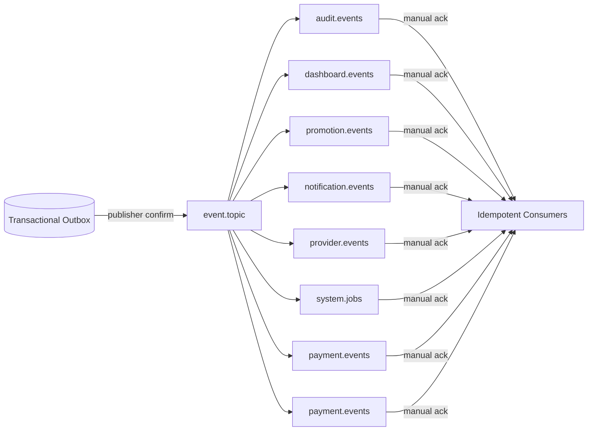
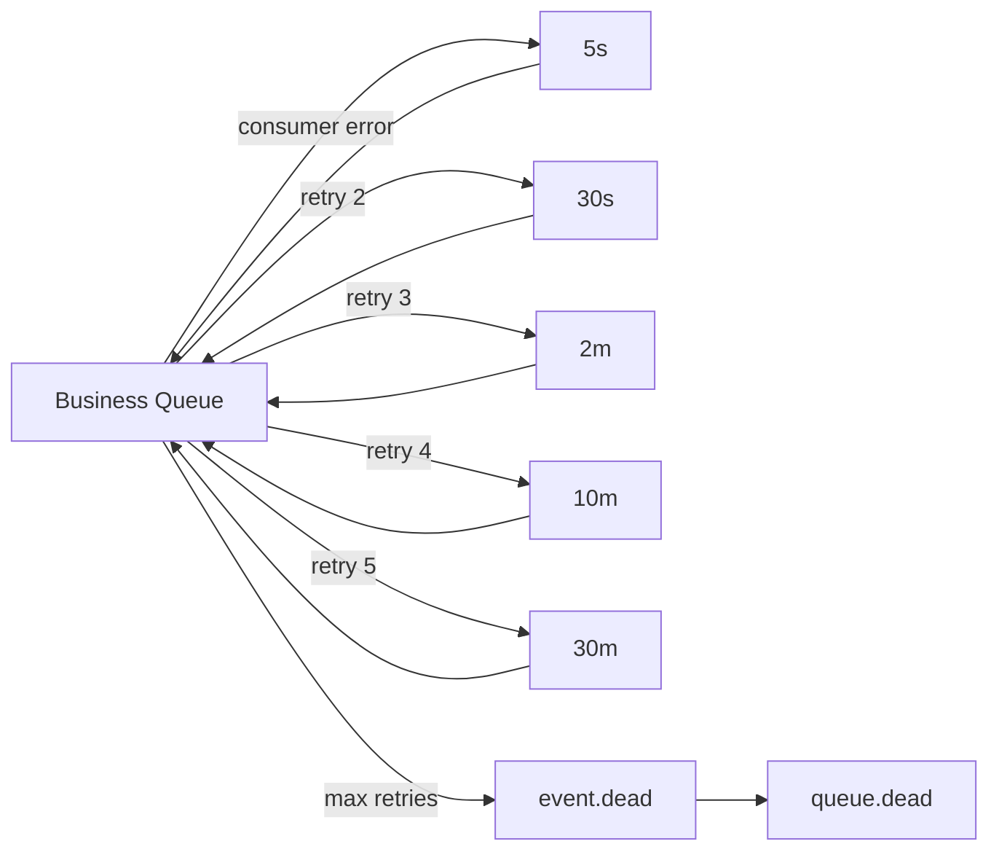

# RabbitMQ Event Platform

## Topology



Durable exchanges:

| Exchange | Type | Purpose |
| --- | --- | --- |
| `event.topic` | topic | Default business event routing |
| `event.direct` | direct | Return delayed messages to one original queue |
| `event.fanout` | fanout | Reserved for platform-wide broadcasts |
| `event.delay` | topic | Routes messages into queue-specific TTL retry queues |
| `event.dead` | topic | Dead-letter exchange |

Durable primary queues:

- `payment.events`
- `provider.events`
- `promotion.events`
- `notification.events`
- `audit.events`
- `system.jobs`
- `retry.events` (topology/operations marker)
- `dead.events` (topology/operations marker)

Every primary business queue has:

- `<queue>.retry.5s`
- `<queue>.retry.30s`
- `<queue>.retry.2m`
- `<queue>.retry.10m`
- `<queue>.retry.30m`
- `<queue>.dead`

## Routing Keys

| Routing key | Current consumer queue |
| --- | --- |
| `payment.deposit.success` | `promotion.events` |
| `task.notification.send.requested` | `notification.events` |
| `task.provider.sync.requested` | `provider.events` |
| `task.support.export.requested` | `system.jobs` |
| `task.report.export.requested` | `system.jobs` |
| `task.backup.requested` | `system.jobs` |
| `task.system.execution.requested` | `system.jobs` |


## Message Envelope

```json
{
  "event_id": "EVT...",
  "event_type": "player.deposit_succeeded.v1",
  "version": 1,
  "site_id": 1,
  "request_id": "request-id",
  "correlation_id": "business-flow-id",
  "causation_id": "parent-event-id",
  "occurred_at": "2026-07-20T00:00:00Z",
  "producer": "payments",
  "payload": {},
  "metadata": {}
}
```

`trace_id`, aggregate fields, and stable target consumers remain available for tracing and backward compatibility. Historical Outbox envelopes using `event_version` are still accepted.

## Retry Flow



The `x-retry-count`, `x-original-queue`, and `x-last-error` headers travel with the message. A failed retry publish causes `Nack(requeue=true)` so the original message is not lost. After the configured maximum, the consumer uses `Reject(requeue=false)` and RabbitMQ dead-letters the message.

Delivery is at least once. `event_deliveries` prevents repeated handler invocation after successful delivery, and each consumer must retain its own unique business key or `source_event_id` constraint for the crash window between its business commit and delivery acknowledgement.

## Publisher and Consumer Guarantees

- Messages and queues are durable; messages use persistent delivery mode.
- Publish uses `mandatory=true` and publisher confirms.
- An unroutable, nacked, or timed-out publish leaves the Outbox row `FAILED` for retry.
- Consumers use manual Ack/Nack/Reject and configurable prefetch/concurrency.
- Consumer channels reconnect after connection loss.
- Shutdown cancels consumers, waits for workers, and closes AMQP cleanly.

## Configuration

Production secrets must be environment variables and must not be committed:

```text
CASINO_RABBITMQ_ENABLED=true
CASINO_RABBITMQ_REQUIRED=true
CASINO_RABBITMQ_HOST=...
CASINO_RABBITMQ_PORT=5672
CASINO_RABBITMQ_MANAGEMENT_PORT=15672
CASINO_RABBITMQ_USERNAME=...
CASINO_RABBITMQ_PASSWORD=...
CASINO_RABBITMQ_VHOST=/
CASINO_RABBITMQ_PREFETCH=20
CASINO_RABBITMQ_CONCURRENCY=2
CASINO_RABBITMQ_PUBLISHER_CONFIRM=true
CASINO_RABBITMQ_MAX_RETRIES=5
```

The deployment pipeline writes these values into the private server `.env`. Production uses `CASINO_RABBITMQ_REQUIRED=true`; API startup and `/health/ready` fail if RabbitMQ is unavailable.

## Monitoring and Operations

Platform Admin pages:

- System Health shows connection, publisher, consumer, topology, ready/unacked messages, consumers, queue depth, dead/retry counts, TPS, and process-observed latency.
- Jobs & Retry Center shows queue metrics and RabbitMQ dead payloads.
- A dead message can be replayed to its original queue.
- A queue's delayed retry messages can be purged with a reason and audit record.
- Manual Event Dispatch only wakes the Outbox relay; it does not consume messages inside the HTTP request.

Management API metrics are preferred. If the management endpoint is unavailable, AMQP queue inspection still returns depth and consumer counts.

## Deployment Checklist

1. Allow TCP from the API hosts to AMQP port 5672 and management port 15672 (or the configured custom management port).
2. Create a dedicated production vhost and least-privilege service account when available.
3. Grant configure/write/read permissions for `event.*`, the primary queues, retry queues, and dead queues.
4. Set GitHub Actions secrets/variables and deploy.
5. Verify `/health/ready` reports RabbitMQ `UP`.
6. Verify all exchanges, queues, bindings, DLX arguments, consumers, and queue depths in the management UI.
7. Run the real integration suite from an allowed host:

```bash
set -a
source .env
set +a
RABBITMQ_INTEGRATION=1 go test ./internal/eventbus/rabbitmq -run Integration -count=1 -v
```

8. Trigger one low-risk event and confirm Outbox `PUBLISHED`, Rabbit delivery, successful `event_deliveries`, and an empty dead queue.

## Failure Recovery

- RabbitMQ unavailable: business commits still persist Outbox rows. Relay retries without losing events.
- Publisher confirm timeout: Outbox remains `FAILED`; idempotency key prevents a duplicate business event.
- Consumer crash before Ack: RabbitMQ redelivers; delivery and business idempotency prevent duplicate effects.
- Poison message: staged retry then queue-specific dead letter; payload and error remain visible for controlled replay.
- Worker restart: unacked messages return to the queue and consumers reconnect.
